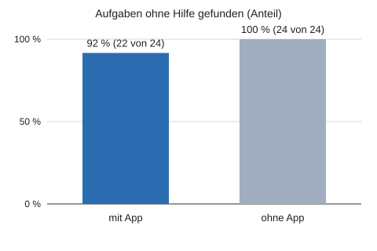
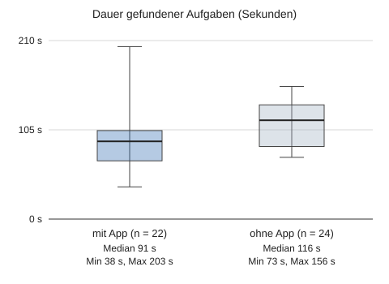

# Pilot-Auswertung (Team)

Kriterien-Version 1 · Quelle: docs/pilot-readiness/03_PILOT_READINESS.md 6.2/6.3 (vorläufig)

> **Kleine Stichprobe: rein beschreibend, keine Signifikanzaussage; Kriterien sind vorläufig.**

## Datenbasis

- Testpersonen (mit Aufgaben): 12
- Aufgaben mit App: 24, ohne App: 24
- Gepaarte Aufgaben (mit und ohne App): 24
- Zeitraum der Aufgaben: 01.11.2026 bis 04.11.2026
- Fragebogen: 12 Antworten
- Feldwerte: 3 Zeilen

## Kennzahlen

| Kennzahl | Wert | Kriterium | n | Urteil |
|---|---|---|---|---|
| Suchaufgaben ohne Hilfe erfolgreich abgeschlossen | 91,7 % | ≥ 90 % | 24 Aufgaben mit App | erfüllt |
| Mit App schneller bei seltenen Produkten (gepaart) | 68,2 % | ≥ 60 % | 22 Paare | erfüllt |
| Manuelle Positionskorrekturen pro Tour (Median) | 1 pro Tour | ≤ 2 pro Tour | 23 Touren | erfüllt |
| Unbegründete Zielwechsel | 0 | = 0 | 24 Touren | erfüllt |
| Falsche Routenänderungen pro Tour | 0,83 pro Tour | ≤ 1 pro Tour | 23 Touren | erfüllt |
| Navigationsabbrüche | 4,2 % | ≤ 10 % | 24 Aufgaben | erfüllt |
| Würde die App wieder nutzen (Wert 4 oder 5) | 66,7 % | ≥ 60 % | 12 Personen | erfüllt |
| Technische Vorfälle je Tour (Absturz, Hänger, falsche Daten) | 0,04 Vorfälle pro Tour (1 je 20 Touren) | ≤ 0,05 Vorfälle pro Tour (1 je 20 Touren) | 24 Touren | erfüllt |
| Aufwand Marktpersonal gesamt | 1,5 Stunden gesamt | ≤ 2 Stunden gesamt | 1 Angabe | erfüllt |
| Reroutes ohne Abweichung im Feldlauf | 1,2 pro Tour | ≤ 1 pro Tour | 3 Feldläufe | nicht erfüllt |

## Zeitvergleich mit und ohne App

- Median mit App: 91,4 s
- Median ohne App: 116,8 s
- Median der Differenz (ohne minus mit App): 27,2 s (positiv: mit App schneller)
- Gewinner/Verlierer: mit App schneller 15, ohne App schneller 7, gleich 0
- p-Wert Vorzeichentest (zweiseitig): 0,134
- Paare ausgeschlossen (nicht beide gefunden): 2 von 24

## Erfolg je Bedingung

| Bedingung | Aufgaben | gefunden | mit Hilfe | abgebrochen | Anteil gefunden |
|---|---|---|---|---|---|
| mit App | 24 | 22 | 1 | 1 | 91,7 % |
| ohne App | 24 | 24 | 0 | 0 | 100 % |

## Fragebogen

| Frage | Mittelwert | n |
|---|---|---|
| q1: Würde die App wieder nutzen | 3,9 | 12 |
| q2: Bedienung war einfach | 3,2 | 12 |
| q3: Vertrauen in die Standortanzeige | 3,2 | 12 |
| q4: Würde seltener Personal fragen | 3,2 | 12 |
| q5: Gesamteindruck | 3,2 | 12 |

## Feldwerte

| Standort | Datum | Gerät | Median-Fehler (m) | P90-Fehler (m) | Richtiger Gang | Reroutes pro Tour |
|---|---|---|---|---|---|---|
| Testraum | 20.10.2026 | SYNTH iPhone A | 2,4 | 4,6 | 82 % | 0,4 |
| Grosser Raum | 27.10.2026 | SYNTH iPhone B | 3,1 | 5,8 | 74 % | 1,2 |
| SYNTH-Markt | 05.11.2026 | SYNTH iPhone A | 2,8 | 5,1 | 78 % | 0,7 |

## Diagramme

## Grenzen

1. Kleine Stichprobe: Die Werte beschreiben die Testgruppe und erlauben keine Aussage über den ganzen Markt.
2. Die Kriterien sind vorläufig (Version 1) und können nach der ersten Sitzung angepasst werden.
3. Die Aufgaben sind Testaufgaben; sie bilden den Alltag im Markt nur eingeschränkt ab.
