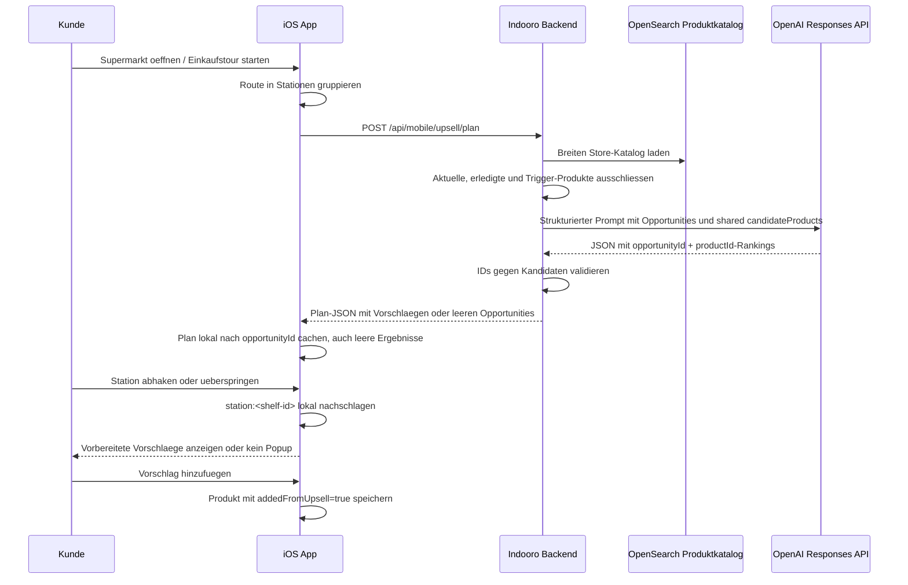

# AI Upsell Flow

## Ablauf



## Request Vom Client An Das Backend

Die App sendet keinen OpenAI-Key. Sie sendet nur die aktuelle Store-/Listen-/Stations-Situation:

```json
{
  "storeId": "bbbbbbbb-bbbb-bbbb-bbbb-bbbbbbbbbbbb",
  "storeCode": "demo-store",
  "shoppingListId": "local-list-uuid",
  "currentListProductIds": [1, 3, 8],
  "completedProductIds": [],
  "source": "shopping_session",
  "opportunities": [
    {
      "opportunityId": "station:shelf-430",
      "triggerProductIds": [1, 3],
      "triggerProductNames": ["Spaghetti", "Tomatensauce"]
    },
    {
      "opportunityId": "station:shelf-525",
      "triggerProductIds": [8],
      "triggerProductNames": ["Parmesan"]
    }
  ]
}
```

## Prompt An OpenAI

System:

```text
You are ranking supermarket add-on products for each shopping station. The server provides a shared candidateProducts catalog for this store. For each opportunity, decide from scratch which candidate productIds are genuinely useful complements for the trigger products. Do not suggest the same product type in another brand, package size, flavor, or variant; suggest complements, not alternatives. Return an empty suggestions array when nothing clearly fits. Select only productIds from candidateProducts and only opportunityIds from opportunities. Do not invent products or opportunityIds. Reasons must be concise German customer-facing text.
```

User-Payload:

```json
{
  "opportunities": [
    {
      "opportunityId": "station:shelf-430",
      "triggerProductIds": [1, 3],
      "triggerProductNames": ["Spaghetti", "Tomatensauce"]
    }
  ],
  "candidateProducts": [
    {
      "id": 2,
      "name": "Parmesan",
      "categoryCode": "525",
      "layoutCode": "525/1/1/1",
      "hasLayoutPosition": true
    },
    {
      "id": 9,
      "name": "Kuechenrolle 4 Rollen",
      "categoryCode": "820",
      "layoutCode": "820/1/1/1",
      "hasLayoutPosition": true
    }
  ],
  "maxSuggestionsPerOpportunity": 3
}
```

## Erwartete OpenAI-Antwort

OpenAI muss strikt JSON liefern und darf nur IDs aus dem Payload verwenden:

```json
{
  "opportunities": [
    {
      "opportunityId": "station:shelf-430",
      "suggestions": [
        {
          "productId": 2,
          "reason": "Passt gut zu Pasta und Sauce.",
          "confidence": 0.82
        }
      ]
    }
  ]
}
```

Wenn nichts klar passt:

```json
{
  "opportunities": [
    {
      "opportunityId": "station:shelf-525",
      "suggestions": []
    }
  ]
}
```

## Antwort Vom Backend An Die App

Das Backend ersetzt die AI-IDs durch echte Katalogprodukte und filtert ungueltige IDs, bereits gelistete Produkte, erledigte Produkte und Trigger-Produkte:

```json
{
  "source": "openai",
  "expiresAt": "2026-06-25T10:30:00Z",
  "debug": {
    "requestId": "a-runtime-uuid",
    "model": "gpt-5.4-mini",
    "responseSource": "openai",
    "elapsedMs": 4200,
    "openAiElapsedMs": 3900,
    "inputTokens": 1800,
    "outputTokens": 140,
    "totalTokens": 1940,
    "cachedInputTokens": 0,
    "reasoningTokens": 0,
    "fallbackReason": null,
    "opportunityCount": 2,
    "candidateCount": 150
  },
  "opportunities": [
    {
      "opportunityId": "station:shelf-430",
      "triggerProductIds": [1, 3],
      "suggestions": [
        {
          "product": {
            "id": 2,
            "name": "Parmesan",
            "price": 2.49,
            "layoutCode": "525/1/1/1",
            "storeId": "bbbbbbbb-bbbb-bbbb-bbbb-bbbbbbbbbbbb",
            "storeCode": "demo-store",
            "brand": null,
            "category": "525",
            "imageUrl": null,
            "hasLayoutPosition": true
          },
          "reason": "Passt gut zu Pasta und Sauce.",
          "confidence": 0.82
        }
      ]
    }
  ]
}
```

## Timeout-Verhalten

- Backend OpenAI Timeout: `OPENAI_UPSELL_TIMEOUT_MS=12000`.
- iOS Plan Timeout: `25` Sekunden.
- iOS startet keinen zweiten Plan-Request, solange ein Plan-Request laeuft.
- Wenn OpenAI nicht rechtzeitig oder nicht gueltig antwortet, gibt das Backend leere Suggestions zurueck statt Server-Fallback.

## Wichtige Schutzregeln

- OpenAI-Key liegt nur im Backend als Secret/Env, nie in Swift.
- AI bekommt einen breiteren, aber weiterhin begrenzten Store-Katalog, nicht ungefilterte Secrets oder Admin-Daten.
- AI darf keine Produkte erfinden; unbekannte `productId` werden verworfen.
- Andere Marken, Packungsgroessen, Sorten oder Varianten desselben Trigger-Produkttyps gelten als Alternativen und sollen nicht vorgeschlagen werden.
- Bereits offene, erledigte und Trigger-Produkte werden serverseitig ausgeschlossen.
- Stationen werden ueber `opportunityId` gebunden, dadurch kann keine alte Antwort fuer eine andere Station erscheinen.
- iOS cached leere Opportunities als `loaded_empty`; spaeteres Abhaken fuehrt dann zu `no_suggestions` statt `cache_miss`.
- Produkte, die aus Vorschlaegen hinzugefuegt wurden, bekommen `addedFromUpsell=true` und triggern keine neue Upsell-Suche.
- Debug-Ausgaben verwenden in iOS den Prefix `[UpsellDebug]`; Backend-Logs enthalten Request-ID, Source, Dauer und Token-Usage, aber keinen API-Key.

## Post-AI-Sicherheitsfilter

Der Filter laeuft nach dem Parsen der strukturierten OpenAI-Antwort und nach der Pruefung der Kandidaten-IDs. Er gilt im Plan-Endpunkt pro Opportunity und im Einzelprodukt-Endpunkt `/suggestions`. Dort gibt es genau ein Trigger-Produkt, das Einzelprodukt. Die Reihenfolge je Vorschlag:

1. Unbekannte, doppelte oder nicht im Kandidatenpool enthaltene `productId`s werden verworfen.
2. Vorschlaege unter `upsell.min-confidence` (Default `0.45`) werden verworfen.
3. Ist der Kandidat ein starkes Aequivalent eines Trigger-Produkts derselben Opportunity, wird er verworfen. Log: `reason=trigger_equivalent`.
4. Diversitaet je Opportunity: Der erste gueltige Vorschlag einer starken Produktklasse bleibt erhalten, weitere Produkte derselben Klasse werden verworfen. Log: `reason=duplicate_class` mit `retainedProductId`. Produkte ohne starke Klasse werden nur bei gleicher Produkt-ID oder exakt gleicher normalisierter Basisbezeichnung dedupliziert.
5. `upsell.max-suggestions` (Default `3`) begrenzt das Ergebnis.

Die KI-Reihenfolge bleibt erhalten. Der Filter entfernt nur und fuellt nie nach: Es gibt keinen deterministischen Backfill aus dem Kandidatenpool. Leere oder kuerzere Ergebnisse sind daher beabsichtigt. Bleibt nach dem Filter nichts uebrig, obwohl OpenAI Vorschlaege geliefert hat, lautet `source` `filtered`.

Die Regeln zur Produktidentitaet und zu den Klassen stehen in `upsell-candidate-ranking.md`.

Der Plan-Cache-Kontext ist `upsell-plan-v6` (vorher `upsell-plan-v5`), damit Plan-Antworten aus der Zeit vor dem Filter nicht wiederverwendet werden. Der Einzelprodukt-Cache verwendet weiterhin `upsell-v4`. Alte Einzelprodukt-Antworten koennen daher bis zum Ablauf der TTL (`upsell.cache-ttl-minutes`, Default `60`) noch Varianten enthalten.

## Prompt-Leitlinien und KI-first-Grenze

Der System-Prompt des Plan-Endpunkts (`PLAN_SYSTEM_PROMPT`) definiert ein Komplement als eigenstaendiges Produkt, das einen konkreten Anwendungsfall des Trigger-Produkts unterstuetzt oder verbessert, etwa ein Rezept, eine Mahlzeit oder eine Routine. Der Beispielblock im Abschnitt "Prompt An OpenAI" oben zeigt den aelteren Wortlaut. Massgeblich ist der Code.

Negativbeispiele (Alternativen, keine Komplemente):

- Aepfel: keine andere Apfelsorte und keine andere Apfelvariante
- Kuechenrolle: kein Kuechenpapier und keine andere Rollenpackung
- Zahnpasta: keine andere Zahnpasta
- keine Packungsgroesse oder Markenvariante des Trigger-Produkts

Positivbeispiele:

- Risotto: Butter
- Eier: Mehl oder Milch

Weitere Regeln: Ein starker Vorschlag oder ein leeres `suggestions`-Array ist besser als mehrere schwache Produkte derselben Kategorie. Pro Opportunity kommt keine zweite Produktklasse vor. IDs duerfen nur aus `candidateProducts` und `opportunities` stammen. Der Einzelprodukt-Prompt (`SINGLE_SYSTEM_PROMPT`) enthaelt die Komplement-Definition und die Alternativregel, aber keine Beispiele.

Grenze: Vor dem OpenAI-Aufruf findet keine semantische Vorauswahl statt. Alle gueltigen Kandidaten aus dem begrenzten Store-Katalog (`upsell.max-candidates`, Default `150`) gehen in `candidateProducts`. Prompt-Anweisungen wirken probabilistisch. Der Filter oben ist die harte Grenze; er erkennt nur Produkte, deren Klasse oder Name er eindeutig zuordnen kann.

## Cache- und Ergebnisstatus im Plan-Endpunkt

Ein mobiler Plan-Request ruft OpenAI hoechstens einmal auf. Das Backend wiederholt den OpenAI-Aufruf nie intern. Eine Wiederholung ist nur bei `candidate_lookup_failed` vorgesehen und wird vom Client ausgeloest (siehe `upsell-candidate-ranking.md`).

| Ergebnis (`outcome` im Log) | `source` | `debug.fallbackReason` | Im Cache gespeichert | `retryable` | OpenAI-Aufruf |
| --- | --- | --- | --- | --- | --- |
| `cache_hit` | `cache` | wie im gespeicherten Ergebnis | bereits vorhanden | wie gespeichert | nein |
| `suggested` | `openai` | `null` | ja | `false` | ja |
| `openai_empty` | `openai` | `null` | ja | `false` | ja (leere, gueltige Antwort) |
| `filtered_empty` | `filtered` | `null` | ja | `false` | ja |
| `no_candidates` | `none` | `no_candidates` | ja | `false` | nein |
| `no_ranked_candidates` | `none` | `no_ranked_candidates` | ja | `false` | nein |
| `candidate_lookup_failed` | `none` | `candidate_lookup_failed` | nein | `true` | nein, keine Token-Felder |
| `openai_unavailable_timeout_or_invalid` | `none` (`debug.responseSource` ist `fallback`) | `openai_unavailable_timeout_or_invalid` | ja, volle TTL | `false` | ja bei Timeout oder ungueltiger Antwort, nein bei deaktiviertem OpenAI oder fehlendem Key |

Hinweise:

- `candidate_lookup_failed` bedeutet, dass die OpenSearch-Kandidatensuche eine IOException geworfen hat. Vor dem Aufruf wurde kein OpenAI-Request gesendet, `candidateCount` ist `0`. Diese Antwort wird nicht in den Plan-Cache geschrieben.
- `debug.retryable` ist ein optionales Boolean (nullable). Es steht in `api/openapi/indooro-mobile.yaml` und in `openspec/specs/shared-api/openapi.yaml` im Objekt `UpsellPlanDebug`. Nicht-Admins erhalten es zusammen mit `requestId`, `responseSource` und `fallbackReason`. Aeltere Clients ignorieren das Feld.
- Gueltige leere OpenAI-Ergebnisse und Filter-Ergebnisse sind normale Ergebnisse. Sie werden gecacht und nicht wiederholt.
- `upsell_disabled` und `no_valid_opportunities` werden direkt zurueckgegeben, ohne Cache-Eintrag.
- Der Einzelprodukt-Endpunkt `/suggestions` behandelt eine IOException aus der Kandidatensuche noch wie eine leere Liste. Das Ergebnis `none` wird gecacht und bleibt bis zur TTL bestehen. Diese Unterscheidung gilt bisher nur fuer den Plan-Endpunkt.
